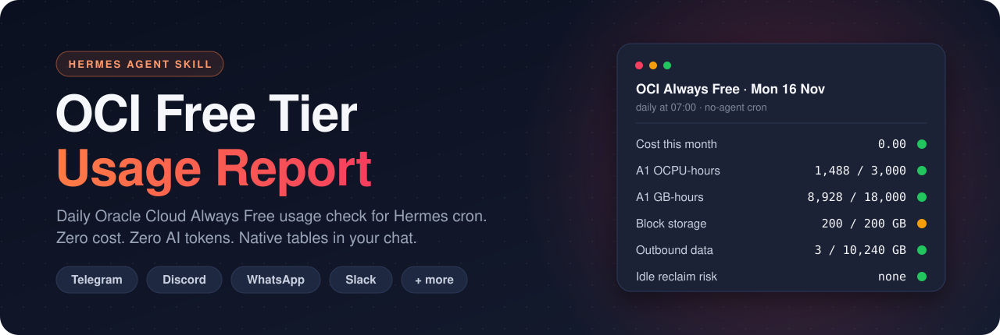
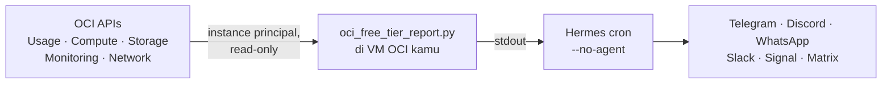

<div align="center">



<br>

[](https://github.com/pgen0x/hermes-oci-free-tier-report/releases)
[](LICENSE)
[](skills/oci-free-tier-report/SKILL.md)
[](https://www.oracle.com/cloud/free/)
[](skills/oci-free-tier-report/requirements.txt)
[](#how-it-works)

[English](README.md) · **Bahasa Indonesia**

</div>

# Monitor Oracle Cloud Free Tier untuk Hermes — peringatan pemakaian OCI Always Free di Telegram, Discord & WhatsApp

**Tetap di dalam batas Oracle Cloud Always Free dan tidak pernah kaget dapat tagihan.**
Laporan harian **pemakaian Oracle Cloud Infrastructure (OCI) Always Free** yang berjalan sebagai cron job
[Hermes Agent](https://github.com/NousResearch/hermes-agent) dan mengirim tabel ke Telegram, Discord, WhatsApp,
Slack, Signal, atau Matrix. Laporan ini mencocokkan tenancy kamu dengan batas Always Free Oracle — biaya yang
ditagih, jam OCPU dan memori Ampere A1, block volume dan Object Storage, transfer data keluar, risiko instance
di-reclaim karena idle, load balancer, dan Autonomous Database — lalu memberi tahu kalau ada yang mendekati atau
melewati batas gratis.

- **Gratis, tanpa token AI.** Cron job Hermes `--no-agent`: murni panggilan OCI SDK, tanpa LLM.
- **Tabel asli di chat.** Tabel asli di Telegram (Bot API Rich Messages), tabel rata di Slack, Signal, dan Matrix,
  tabel monospace selebar layar HP di Discord dan WhatsApp — dipilih otomatis sesuai tujuan pengiriman.
- **Tanpa API key di disk.** Login sebagai VM itu sendiri (OCI instance principal) dengan policy hanya-baca.
- **Peringatan dengan bahasa sederhana.** Bagian yang aman tidak diberi catatan; yang mendekati atau lewat batas
  diberi penjelasan artinya dan apa yang jangan dilakukan.
- **Bahasamu sendiri.** Bawaan bahasa Inggris (default) dan Bahasa Indonesia; bot Hermes bisa menambahkan bahasa
  lain sekali saat install — laporan hariannya tetap tanpa AI.
- **Install dengan satu kalimat, update dengan satu perintah.** Dikemas sebagai skill Hermes: bot meng-install-nya
  lewat `hermes skills install` dan memasang cron job di chat yang sedang dipakai; `hermes skills update` menjaganya
  tetap terbaru.

> **Syarat: hanya berjalan di compute instance OCI.** Hermes harus terpasang di VM Oracle Cloud yang ingin dipantau
> (Ampere A1 Flex atau VM.Standard.E2.1.Micro, Ubuntu / Oracle Linux). Laporan login sebagai VM tersebut lewat
> instance principal, jadi tidak bisa dijalankan di laptop, cloud lain, atau VPS non-OCI.

## Mulai cepat

Di VM OCI tempat Hermes berjalan:

```bash
hermes skills install pgen0x/hermes-oci-free-tier-report/skills/oci-free-tier-report
```

Lalu bilang ke bot Hermes kamu: **"pasang OCI free tier report di chat ini, bahasa Indonesia"**. Bot menjalankan
installer bawaan skill, membuat cron job harian jam 07:00, dan mengirim laporan pertama. Update nanti dengan
`hermes skills update oci-free-tier-report`.

## Cara kerja



Setiap pagi Hermes menjalankan script sebagai cron job `--no-agent`. Script login sebagai VM itu sendiri, membaca
pemakaian tenancy lewat OCI SDK, membandingkannya dengan batas Always Free, lalu mencetak tabel. Hermes mengirim teks
itu apa adanya — tanpa LLM, tanpa API key di disk, tanpa biaya.

## Daftar isi
- [Mulai cepat](#mulai-cepat) · [Cara kerja](#cara-kerja)
- [Contoh laporan](#contoh-laporan)
- [Install dengan satu pesan ke bot Hermes](#install-dengan-satu-pesan-ke-bot-hermes)
- [Install manual](#install-manual) · [Update](#update)
- [Setup izin OCI (sekali saja)](#setup-izin-oci-sekali-saja)
- [Batas Oracle Always Free yang dicek](#batas-oracle-always-free-yang-dicek)
- [Bahasa](#bahasa)
- [FAQ](#faq)
- [Opsi](#opsi) · [Mengelola](#mengelola) · [Cara kerja autentikasi](#cara-kerja-autentikasi)

## Contoh laporan

Dengan `--lang id`, setiap bagian tampil sebagai tabel asli di Telegram (tenancy ini Pay As You Go, jadi headernya
`ap-batam-1 · PAYG · 07:00 WIB`):

| Compute | Terpakai | Batas | Status |
|:---|---:|---:|:---:|
| A1 OCPU | 4 | 4 | 🟠 |
| A1 RAM (GB) | 24 | 24 | 🟠 |
| VM E2.1.Micro | 0 | 2 | ✅ |

| Jam A1 | Terpakai | Proyeksi | Batas | Status |
|:---|---:|---:|---:|:---:|
| OCPU-h | 637 | 2.077 | 3.000 | ⚪ |
| GB-h | 3.824 | 12.464 | 18.000 | ⚪ |

…ditambah tabel **Biaya**, **Storage**, **Jaringan**, **Idle**, dan **Lainnya**, lalu footer yang hanya menjelaskan
hal yang perlu diperhatikan:

> **Catatan**
> 🟠 **Compute**: A1 sudah di batas gratis (4 OCPU / 24 GB) — masih gratis, tapi instance A1 baru atau yang lebih besar akan ditagih.
> ⚪ **Jam A1**: Kuota gratis per bulan (PAYG): 3.000 OCPU-h + 18.000 GB-h. … Bulan ini melewati 1.500 / 9.000 — kalau
> baris Biaya suatu saat menunjukkan tagihan A1, kecilkan A1 ke 2 OCPU / 12 GB.
> 🟠 **Storage**: Boot + block volume sudah memakai seluruh 200 GB gratis — jangan buat volume baru atau perbesar boot volume.

Format `mono` (Discord, WhatsApp) tampil seperti ini:

```
COMPUTE       Terpakai Batas
A1 OCPU              4     4 🟠
A1 RAM (GB)         24    24 🟠
VM E2.1.Micro        0     2 ✅

JAM A1 Terpakai Proyeksi  Batas
OCPU-h      637    2.077  3.000 ⚪
GB-h      3.824   12.464 18.000 ⚪
```

## Install dengan satu pesan ke bot Hermes

Di chat tempat kamu ingin menerima laporan harian, kirim ke bot Hermes:

> Install the Hermes skill pgen0x/hermes-oci-free-tier-report/skills/oci-free-tier-report with
> `hermes skills install`, then follow its SKILL.md to set up a daily no-agent cron job that posts to this chat
> at 07:00, report language Indonesian (id), and tell me the installer's exit code.

Hapus bagian `report language Indonesian (id)` kalau ingin laporan dalam bahasa Inggris (default). Atau install
skill-nya sendiri, lalu cukup minta bot "pasang OCI free tier report":

```bash
hermes [-p <profile>] skills install pgen0x/hermes-oci-free-tier-report/skills/oci-free-tier-report
```

Folder skill sudah berisi semuanya — `SKILL.md`, `install.sh`, script laporan, dan file bahasa — jadi tidak ada
yang perlu di-clone. Bot mengikuti [`SKILL.md`](skills/oci-free-tier-report/SKILL.md): menjalankan installer untuk
profile-nya sendiri, menargetkan chat saat ini, mengirim laporan pertama, dan — kalau izin Oracle belum ada —
memberikan dua langkah di Console lengkap dengan OCID instance kamu.

## Install manual

Di VM OCI tempat Hermes berjalan, dari skill yang sudah ter-install
(`~/.hermes/skills/oci-free-tier-report`, atau `~/.hermes/profiles/<profile>/skills/oci-free-tier-report`):

```bash
bash ~/.hermes/skills/oci-free-tier-report/install.sh --deliver telegram --lang id   # profile default → home channel Telegram, 07:00
```

atau dari git checkout (kontributor, atau tanpa skills hub):

```bash
git clone https://github.com/pgen0x/hermes-oci-free-tier-report
bash hermes-oci-free-tier-report/skills/oci-free-tier-report/install.sh --deliver telegram --lang id
```

Contoh lain (dijalankan dari folder skill):

```bash
bash install.sh --profile work --deliver discord:123456789012345678
bash install.sh --deliver telegram:-1001234567890 --schedule "30 8 * * *" --timezone Asia/Jakarta
bash install.sh --deliver whatsapp:6281234567890@s.whatsapp.net   # → format mono
bash install.sh --deliver telegram --format mono                     # ganti format otomatis
bash install.sh --deliver telegram --lang en                         # kembali ke bahasa Inggris (default)
bash install.sh --deliver telegram --unwrap                          # hapus header "Cronjob Response" dari Hermes
bash install.sh --no-cron                                            # install + cek izin saja
bash install.sh --uninstall --profile work
```

Yang dilakukan installer:

1. membuat venv khusus berisi OCI Python SDK di `~/.local/share/hermes-oci-free-tier-report/venv`;
2. menyalin `oci_free_tier_report.py` dan file bahasa ke folder `scripts/` milik profile (Hermes hanya menjalankan
   script dari sana);
3. menjalankan **preflight** yang mengetes semua izin OCI yang dibutuhkan;
4. menulis `oci_free_tier_report.conf` di sebelah script (format, zona waktu, bahasa), dan untuk Telegram
   menyalakan `platforms.telegram.extra.rich_messages` di profile — tabel asli di Hermes bersifat opt-in, jadi
   restart profile itu sekali sesudahnya: `hermes [-p <profile>] gateway restart`;
5. membuat cron job, atau memperbaruinya kalau sudah ada.

Aman dijalankan ulang. Di dalam sesi Hermes, installer mendeteksi profile sesi itu sendiri.
Exit code: `0` siap · `3` terpasang tapi izin OCI belum ada · `1` error.

## Update

```bash
hermes [-p <profile>] skills check                          # ada versi baru?
hermes [-p <profile>] skills update oci-free-tier-report    # ambil versi baru
bash <folder skill>/install.sh --profile <profile> --deliver <target yang sama>   # pasang script baru
```

Menjalankan ulang installer tetap mempertahankan cron job, jadwal, dan pengaturanmu (bahasa, format, zona waktu).
Atau cukup minta ke bot: "update skill OCI free tier report". Dari git checkout: `git pull`, lalu jalankan ulang
`install.sh` dengan cara yang sama.

**Upgrade dari install lama via clone** (di `~/.local/src/hermes-oci-free-tier-report`):
install skill seperti di atas, jalankan ulang `install.sh`-nya dengan `--deliver` yang sama, lalu hapus clone lama.
Kalau bot kamu pernah menyalin `SKILL.md` ke folder `skills/` secara manual, hapus folder itu dulu sebelum
`hermes skills install`.

## Setup izin OCI (sekali saja)

VM butuh akses hanya-baca ke tenancy. Preflight mencetak langkah ini lengkap dengan OCID instance kamu:

1. **Identity & Security → Domains → Default → Dynamic groups → Create dynamic group**
   - Name: `oci-free-tier-report`
   - Matching rule: `instance.id = '<OCID instance kamu>'`
2. **Identity & Security → Policies →** pilih compartment **root** **→ Create policy**
   ```
   Allow dynamic-group oci-free-tier-report to read usage-report in tenancy
   Allow dynamic-group oci-free-tier-report to read all-resources in tenancy
   ```
3. Tunggu 1–5 menit, lalu cek:
   ```bash
   ~/.local/share/hermes-oci-free-tier-report/venv/bin/python ~/.hermes/scripts/oci_free_tier_report.py --check
   ```
   (Untuk profile bernama, script ada di `~/.hermes/profiles/<nama>/scripts/`.)

Dynamic group dan policy gratis, dan semuanya hanya-baca.

**Terlewat langkah ini?** Tidak ada yang rusak. Selama izinnya belum ada, pesan harian berisi panduan setup ini
(OCID instance sudah terisi, baris policy di code block yang bisa disalin). Begitu policy dibuat, run berikutnya
mengirim laporan normal — tanpa install ulang. Langkah ini tidak bisa diotomatisasi dari VM: instance tidak bisa
memberi izin ke dirinya sendiri; administrator tenancy yang harus membuatnya.

## Batas Oracle Always Free yang dicek

| Area | Batas Always Free | Sumber |
|---|---|---|
| Biaya kemarin dan bulan ini | harus 0 | Usage API |
| OCPU / memori Ampere A1 Flex yang aktif | Free Tier: 2 OCPU / 12 GB · PAYG: 4 OCPU / 24 GB | Compute API |
| OCPU-jam / GB-jam A1 per bulan (terpakai + proyeksi) | Free Tier: 1.500 / 9.000 · PAYG: 3.000 / 18.000 | Usage API |
| VM.Standard.E2.1.Micro | 2 instance | Compute API |
| Shape compute lain | tidak gratis → peringatan | Compute API |
| Boot + block volume | 200 GB | Block Storage API |
| Backup volume | 5 | Block Storage API |
| Object Storage | 20 GB | Object Storage API |
| Transfer data keluar (egress VNIC, konservatif) | 10 TB / bulan | Monitoring `oci_vcn` |
| Reclaim instance idle (p95 7 hari) | CPU ≥ 20%, atau (A1) memori ≥ 20% | Monitoring `oci_computeagent` |
| Load balancer / Network Load Balancer | 1 / 1 | LB / NLB API |
| Autonomous Database | 2 gratis, 0 berbayar | Database API |

Batas mengikuti dokumentasi [Always Free resources](https://docs.oracle.com/iaas/Content/FreeTier/freetier_topic-Always_Free_Resources.htm) dari Oracle.

## Bahasa

**Bahasa Inggris (`en`) adalah default.** Bawaan lainnya: **Bahasa Indonesia** (`id`) — angka, tanggal, tabel,
catatan, dan panduan setup semuanya diterjemahkan. Pilih dengan `install.sh --lang <kode>` (atau `REPORT_LANG` di
`oci_free_tier_report.conf`); tanpa `--lang`, laporan memakai bahasa Inggris.

**Bahasa lain:** minta ke bot Hermes saat install ("…laporan harian dalam bahasa Jepang"). Mengikuti skill, bot
membuat file bahasa sekali dari template bahasa Inggris, memvalidasinya dengan `--check-locale`, lalu mengganti job
dengan `--lang <kode>`. Laporan harian tetap tanpa LLM. File bahasa custom disimpan di
`scripts/oci_free_tier_report_locales/` milik profile, jadi update skill tidak akan menimpanya. Manual:

```bash
SCRIPTS=~/.hermes/scripts        # atau ~/.hermes/profiles/<profile>/scripts
PY=~/.local/share/hermes-oci-free-tier-report/venv/bin/python
$PY $SCRIPTS/oci_free_tier_report.py --dump-locale > $SCRIPTS/oci_free_tier_report_locales/ja.json
# terjemahkan nilainya; jangan ubah key dan {placeholder}
$PY $SCRIPTS/oci_free_tier_report.py --check-locale ja
bash <folder skill>/install.sh --deliver telegram --lang ja
```

Key yang hilang atau rusak otomatis kembali ke bahasa Inggris, jadi terjemahan yang belum lengkap tidak merusak
laporan. Identifier OCI (nama shape, OCPU, GB-h, menu Console, policy IAM) sengaja tetap dalam bahasa Inggris supaya
sama dengan yang kamu lihat dan salin di Oracle Console. Pull request yang menambah `skills/oci-free-tier-report/locales/<kode>.json` sangat
diterima.

## FAQ

**Akun saya Free Tier atau Pay As You Go, dan apa bedanya?**
Laporan membacanya dari subscription tenancy dan menampilkannya di header (`Free Tier`, `PAYG`, atau `jenis akun ?`
kalau tidak bisa dibaca). Oracle memberi dua jatah Ampere A1 yang berbeda:

- **Free Tier** (belum pernah upgrade): 1.500 OCPU-jam / 9.000 GB-jam per bulan, "equivalent to 2 OCPUs and 12 GB of
  memory" ([Always Free Resources](https://docs.oracle.com/en-us/iaas/Content/FreeTier/freetier_topic-Always_Free_Resources.htm)). A1 4 OCPU / 24 GB di akun Free Tier tampil 🔴.
- **Pay As You Go**: "Each paid tenancy gets the first 3,000 OCPU hours and 18,000 GB hours per month for free"
  ([harga Arm](https://www.oracle.com/cloud/compute/arm/pricing/)) — 4 OCPU / 24 GB tetap gratis.

Halaman Always Free Oracle juga menulis "All tenancies get the first 1,500…", jadi untuk akun PAYG di atas
1.500 / 9.000 baris jam A1 tampil ⚪ dengan catatan. Kalau jenis akun tidak diketahui, laporan memakai kuota Free Tier
yang lebih ketat.

**Apakah saya ditagih kalau Ampere A1 menunjukkan 4/4 OCPU?**
Di akun PAYG, tidak: 🟠 berarti *tepat di* batas, bukan lewat. A1 4 OCPU / 24 GB yang menyala 24/7 memakai paling
banyak 2.976 OCPU-jam dan 17.856 GB-jam di bulan 31 hari — di bawah kuota tenancy berbayar 3.000 / 18.000 yang reset
setiap bulan. Di akun Free Tier batasnya 2 / 12 dan barisnya tampil 4/2 🔴. Apa pun jenis akunnya, baris biaya adalah
patokan akhirnya: `0,00` berarti kamu tidak membayar.

**Apa itu idle instance reclamation dari Oracle?**
Di akun Free Tier (yang belum di-upgrade ke Pay As You Go), Oracle bisa mengambil kembali VM Always Free yang CPU
persentil ke-95 selama 7 hari di bawah 20% — dan untuk shape A1, memorinya juga. Laporan menampilkan kedua angka
dan memberi peringatan sebelum kamu memenuhi kriteria itu. Butuh plugin monitoring Oracle Cloud Agent, yang aktif
secara default di image Oracle.

**Apakah menjalankan ini ada biayanya?**
Tidak. Hanya beberapa puluh panggilan API hanya-baca per hari. Panggilan API OCI gratis; satu-satunya yang dihitung
adalah request Object Storage (gratis 50.000/bulan), dan laporan ini memakai satu atau dua per bucket per hari.
Tidak ada token LLM yang dipakai.

**Bisa dijalankan di luar Oracle Cloud?**
Tidak — harus berjalan di compute instance OCI yang dipantau (lihat [Cara kerja autentikasi](#cara-kerja-autentikasi)).

**Tabel di Telegram tampil sebagai teks biasa.**
Telegram Rich Messages belum aktif untuk profile itu, atau profile belum di-restart setelah installer
mengaktifkannya: `hermes [-p <profile>] gateway restart`.

**Ada judul besar "Cronjob Response: …" di atas laporan.**
Itu pembungkus cron dari Hermes. Jalankan ulang installer dengan `--unwrap` (mengatur `cron.wrap_response: false`;
berlaku untuk seluruh profile).

## Opsi

Pengaturan disimpan di `oci_free_tier_report.conf` di sebelah script yang ter-install (`KEY=VALUE`; environment
variable lebih diutamakan). `install.sh --lang`, `--format`, dan `--timezone` menuliskannya untukmu.

| Pengaturan | Efek |
|---|---|
| `REPORT_LANG=en` | bahasa laporan (`en` default, `id`, atau bahasa custom) |
| `REPORT_FORMAT=markdown` | tabel GFM — asli di Telegram, rata di Slack/Signal/Matrix (default untuk itu) |
| `REPORT_FORMAT=mono` | tabel monospace dalam code block — default untuk Discord dan WhatsApp |
| `REPORT_FORMAT=plain` | tabel monospace tanpa code fence — SMS, email, IRC |
| `REPORT_FORMAT=json` | output untuk mesin |
| `REPORT_ASCII=1` | `OK / WARN / HIGH / OVER` sebagai pengganti emoji |
| `REPORT_QUIET=1` | tidak mengirim apa pun di hari ketika semuanya aman |
| `REPORT_TZ=Asia/Jakarta` | zona waktu di header |

## Mengelola

```bash
hermes cron list                       # cari id job ("OCI Always Free Usage Report")
hermes cron run <id>                   # kirim laporan sekarang
hermes cron edit <id> --schedule "0 9 * * *" --deliver discord:123
hermes cron pause <id>
bash <folder skill>/install.sh --uninstall
hermes skills uninstall oci-free-tier-report
```

Tambahkan `hermes -p <profile>` untuk profile bernama. Untuk update, lihat [Update](#update).

## Cara kerja autentikasi

Setiap VM OCI bisa mengakses Instance Metadata Service di `169.254.169.254`. OCI SDK mengambil sertifikat X.509
milik VM dari sana (dirotasi otomatis), menukarnya dengan security token berumur pendek (±20 menit), lalu
menandatangani setiap panggilan API dengan token itu — tanpa API key, tanpa file config. Dynamic group berarti
"VM ini", policy berarti "boleh membaca". Jaga policy itu tetap **hanya-baca**: semua proses di VM bisa mendapatkan
token yang sama.

## Lisensi

[MIT](LICENSE)
