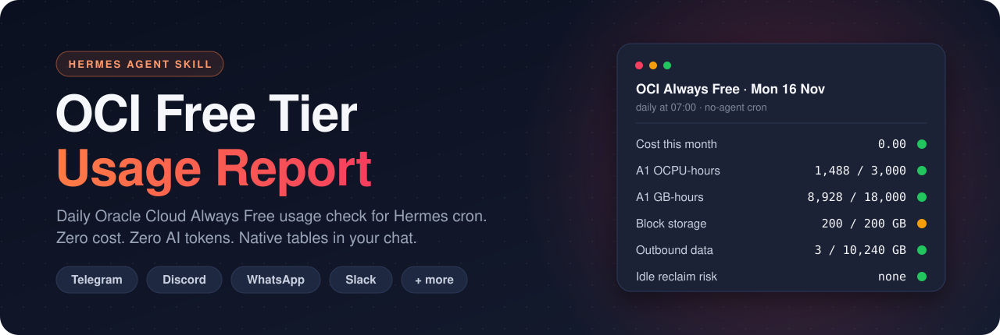
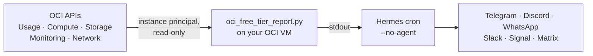

<div align="center">



<br>

[](https://github.com/pgen0x/hermes-oci-free-tier-report/releases)
[](LICENSE)
[](skills/oci-free-tier-report/SKILL.md)
[](https://www.oracle.com/cloud/free/)
[](skills/oci-free-tier-report/requirements.txt)
[](#how-it-works)

**English** · [Bahasa Indonesia](README.id.md)

</div>

# Oracle Cloud Free Tier Monitor for Hermes — OCI Always Free usage alerts on Telegram, Discord & WhatsApp

**Stay inside the Oracle Cloud Always Free tier and never get a surprise bill.**
A daily **Oracle Cloud Infrastructure (OCI) Always Free usage report** that runs as a
[Hermes Agent](https://github.com/NousResearch/hermes-agent) cron job and posts a table to Telegram, Discord,
WhatsApp, Slack, Signal or Matrix. It checks your tenancy against Oracle's Always Free limits — billed cost,
Ampere A1 OCPU and memory hours, block volume and Object Storage, outbound data transfer, idle instance
reclamation risk, load balancers and Autonomous Databases — and tells you when something is close to, or over,
the free limit.

- **Zero cost, zero AI tokens.** A Hermes `--no-agent` cron job: pure OCI SDK calls, no LLM involved.
- **Native tables in chat.** Real tables on Telegram (Bot API Rich Messages), aligned tables on Slack, Signal and
  Matrix, a phone-width monospace table on Discord and WhatsApp — picked automatically from the delivery target.
- **No API keys on disk.** Authenticates as the VM itself (OCI instance principal) with a read-only policy.
- **Plain-language warnings.** Green sections stay quiet; anything near or over a limit gets a note telling you
  what it means and what not to do.
- **Your language.** English and Bahasa Indonesia built in; your Hermes bot can add any other language once at
  install time — the daily report still uses no AI.
- **One sentence to install, one command to update.** Ships as a Hermes skill: your bot installs it with
  `hermes skills install` and sets up the cron job in the current chat; `hermes skills update` keeps it current.

> **Requirement: runs only on an OCI compute instance.** Hermes must be installed on the Oracle Cloud VM you want
> to monitor (Ampere A1 Flex or VM.Standard.E2.1.Micro, Ubuntu / Oracle Linux). The report signs in as that VM via
> instance principal, so it does not work on a laptop, another cloud or a non-OCI VPS.

## Quick start

On the OCI VM where Hermes runs:

```bash
hermes skills install pgen0x/hermes-oci-free-tier-report/skills/oci-free-tier-report
```

Then tell your Hermes bot: **"set up the OCI free tier report in this chat"**. It runs the bundled installer,
creates a daily 07:00 cron job and sends a first report. Update later with `hermes skills update oci-free-tier-report`.

## How it works



Every morning Hermes runs the script as a `--no-agent` cron job. The script signs in as the VM itself, reads your
tenancy's usage through the OCI SDK, compares it with the Always Free limits and prints a table. Hermes delivers that
text unchanged — no LLM call, no API key on disk, nothing to pay.

## Contents
- [Quick start](#quick-start) · [How it works](#how-it-works)
- [Example report](#example-report)
- [Install with one message to your Hermes bot](#install-with-one-message-to-your-hermes-bot)
- [Manual install](#manual-install) · [Update](#update)
- [One-time OCI permission setup](#one-time-oci-permission-setup)
- [Oracle Always Free limits checked](#oracle-always-free-limits-checked)
- [Languages](#languages)
- [FAQ](#faq)
- [Options](#options) · [Manage](#manage) · [How authentication works](#how-authentication-works)

## Example report

On Telegram every section arrives as a native table (this tenancy is Pay As You Go, so the header reads
`ap-batam-1 · PAYG · 07:00 WIB`):

| Compute | Used | Limit | Status |
|:---|---:|---:|:---:|
| A1 OCPU | 4 | 4 | 🟠 |
| A1 RAM (GB) | 24 | 24 | 🟠 |
| E2.1.Micro VMs | 0 | 2 | ✅ |

| A1 hours | Used | Proj. | Limit | Status |
|:---|---:|---:|---:|:---:|
| OCPU-h | 637 | 2,077 | 3,000 | ✅ |
| GB-h | 3,824 | 12,464 | 18,000 | ✅ |

…plus **Cost**, **Storage**, **Network**, **Idle** and **Other** tables, then a footer that only explains what needs
attention:

> **Notes**
>
> 🟠 **Compute**: A1 at the free cap (4 OCPU / 24 GB) — still free; a new or bigger A1 would be billed.
>
> 🟠 **Storage**: 200 of 200 GB used — don't add volumes or enlarge the boot volume.
>
> ✅ <70%  🟡 70-90%  🟠 ≥90%  🔴 over

The `mono` format (Discord, WhatsApp) looks like:

```
COMPUTE        Used Limit
A1 OCPU           4     4 🟠
A1 RAM (GB)      24    24 🟠
E2.1.Micro VMs    0     2 ✅

A1 HOURS  Used  Proj.  Limit
OCPU-h     637  2,077  3,000 ✅
GB-h     3,824 12,464 18,000 ✅
```

## Install with one message to your Hermes bot

In the chat where you want the daily report, tell your Hermes bot:

> Install the Hermes skill pgen0x/hermes-oci-free-tier-report/skills/oci-free-tier-report with
> `hermes skills install`, then follow its SKILL.md to set up a daily no-agent cron job that posts to this chat
> at 07:00, and tell me the installer's exit code.

Or install the skill yourself and then just ask the bot to "set up the OCI free tier report":

```bash
hermes [-p <profile>] skills install pgen0x/hermes-oci-free-tier-report/skills/oci-free-tier-report
```

The skill folder contains everything — `SKILL.md`, `install.sh`, the report script and the locales — so nothing
else is downloaded or cloned. The bot follows [`SKILL.md`](skills/oci-free-tier-report/SKILL.md): it runs the
installer for its own profile, targets the current chat, sends a first report, and — if Oracle permissions are
missing — gives you the two console steps with your instance OCID filled in.

## Manual install

On the OCI VM where Hermes runs, either from the installed skill
(`~/.hermes/skills/oci-free-tier-report`, or `~/.hermes/profiles/<profile>/skills/oci-free-tier-report`):

```bash
bash ~/.hermes/skills/oci-free-tier-report/install.sh --deliver telegram   # default profile → Telegram home channel, 07:00
```

or from a git checkout (contributors, or no skills hub):

```bash
git clone https://github.com/pgen0x/hermes-oci-free-tier-report
bash hermes-oci-free-tier-report/skills/oci-free-tier-report/install.sh --deliver telegram
```

More examples (run from the skill folder):

```bash
bash install.sh --profile work --deliver discord:123456789012345678
bash install.sh --deliver telegram:-1001234567890 --schedule "30 8 * * *" --timezone Asia/Jakarta
bash install.sh --deliver whatsapp:6281234567890@s.whatsapp.net   # → mono format
bash install.sh --deliver telegram --format mono                     # override the automatic format
bash install.sh --deliver telegram --lang id                         # report in Bahasa Indonesia
bash install.sh --deliver telegram --unwrap                          # drop Hermes' "Cronjob Response" header
bash install.sh --no-cron                                            # install + permission check only
bash install.sh --uninstall --profile work
```

What the installer does:

1. builds a private venv with the OCI Python SDK at `~/.local/share/hermes-oci-free-tier-report/venv`;
2. copies `oci_free_tier_report.py` and its locales into the profile's `scripts/` folder (Hermes only runs scripts
   from there);
3. runs a **preflight** that tests every OCI permission the report needs;
4. writes `oci_free_tier_report.conf` next to the script (output format, timezone, language), and for Telegram
   enables `platforms.telegram.extra.rich_messages` in the profile — native tables are opt-in in Hermes, so restart
   that profile once afterwards: `hermes [-p <profile>] gateway restart`;
5. creates the cron job, or updates it if it already exists:
   `hermes cron create "0 7 * * *" --script oci_free_tier_report.py --no-agent --interpreter <venv python> --deliver <target>`.

Re-running it is safe. Inside a Hermes session it detects the session's profile on its own.
Exit codes: `0` ready · `3` installed but OCI permissions are missing · `1` error.

## Update

```bash
hermes [-p <profile>] skills check                          # is a new version out?
hermes [-p <profile>] skills update oci-free-tier-report    # fetch it
bash <skill folder>/install.sh --profile <profile> --deliver <same target>   # deploy the new script
```

Re-running the installer keeps the cron job, its schedule and your settings (language, format, timezone).
Or just ask your bot: "update the OCI free tier report skill". From a git checkout: `git pull`, then re-run
`install.sh` the same way.

**Upgrading from an early clone install** (in `~/.local/src/hermes-oci-free-tier-report`): install the
skill as above, re-run its `install.sh` with the same `--deliver`, then delete the old clone. If your bot copied
`SKILL.md` into its `skills/` folder by hand, delete that folder before `hermes skills install`.

## One-time OCI permission setup

The VM needs read-only access to your tenancy. You don't have to look up anything: the installer's preflight, the
daily message (until permissions exist) and `--check` all print these steps with **your instance OCID already filled
in** — your Hermes bot relays them to you. (To find it yourself: Console → Compute → Instances → your instance →
OCID → Copy.)

1. **Identity & Security → Domains → Default → Dynamic groups → Create dynamic group**
   - Name: `oci-free-tier-report`
   - Description: `Read-only access for the OCI free tier usage report`
   - Matching rule (Rule 1): `instance.id = '<your instance OCID>'`
2. **Identity & Security → Policies → Create Policy**
   - Name: `oci-free-tier-report-read`, Description: same as above
   - Compartment: your **root** (tenancy) compartment
   - Turn on **Show manual editor** (the Console opens the Policy Builder templates by default) and paste:
   ```
   Allow dynamic-group oci-free-tier-report to read usage-report in tenancy
   Allow dynamic-group oci-free-tier-report to read all-resources in tenancy
   ```
   If you created the dynamic group in an identity domain other than `Default`, write it as
   `'<domain>'/'oci-free-tier-report'` in both lines.
3. Wait 1–5 minutes, then check:
   ```bash
   ~/.local/share/hermes-oci-free-tier-report/venv/bin/python ~/.hermes/scripts/oci_free_tier_report.py --check
   ```
   (For a named profile the script lives in `~/.hermes/profiles/<name>/scripts/`.)

Dynamic groups and policies are free, and everything is read-only.

**Skipped this step?** Nothing breaks. Until the permissions exist, the daily message is this setup guide (instance
OCID filled in, policy lines in copyable code blocks). Once the policy exists, the next run sends the normal report
— no reinstall. It can't be automated from the VM: an instance cannot grant permissions to itself; a tenancy
administrator has to create them.

## Oracle Always Free limits checked

| Area | Always Free limit | Source |
|---|---|---|
| Billed cost, yesterday and month to date | must be 0 | Usage API |
| Ampere A1 Flex running OCPU / memory | Free Tier: 2 OCPU / 12 GB · PAYG: 4 OCPU / 24 GB | Compute API |
| A1 OCPU-hours / GB-hours per month (used + projection) | Free Tier: 1,500 / 9,000 · PAYG: 3,000 / 18,000 | Usage API |
| VM.Standard.E2.1.Micro | 2 instances | Compute API |
| Any other compute shape | not free → alert | Compute API |
| Boot + block volumes | 200 GB | Block Storage API |
| Volume backups | 5 | Block Storage API |
| Object Storage | 20 GB | Object Storage API |
| Outbound data transfer (VNIC egress, conservative) | 10 TB / month | Monitoring `oci_vcn` |
| Idle instance reclamation (7-day p95) | CPU ≥ 20%, or (A1) memory ≥ 20% | Monitoring `oci_computeagent` |
| Load balancer / Network Load Balancer | 1 / 1 | LB / NLB API |
| Autonomous Database | 2 free, 0 paid | Database API |

Limits follow Oracle's [Always Free resources](https://docs.oracle.com/iaas/Content/FreeTier/freetier_topic-Always_Free_Resources.htm) documentation.

## Languages

**English (`en`) is the default.** Also built in: **Bahasa Indonesia** (`id`) — numbers, dates, tables, notes and
the setup guide are all localized. Pick one with `install.sh --lang <code>` (or `REPORT_LANG` in
`oci_free_tier_report.conf`); without `--lang` the report is in English. Documentation:
[Bahasa Indonesia README](README.id.md).

**Any other language:** ask your Hermes bot for it when installing ("…daily report in Japanese"). Following the
skill, it generates a locale file once from the English template, validates it with `--check-locale`, and switches
the job with `--lang <code>`. The daily run stays LLM-free. Custom locales live in the profile's
`scripts/oci_free_tier_report_locales/`, so skill updates never overwrite them. Manually:

```bash
SCRIPTS=~/.hermes/scripts        # or ~/.hermes/profiles/<profile>/scripts
PY=~/.local/share/hermes-oci-free-tier-report/venv/bin/python
$PY $SCRIPTS/oci_free_tier_report.py --dump-locale > $SCRIPTS/oci_free_tier_report_locales/ja.json
# translate the values; keep keys and {placeholders}
$PY $SCRIPTS/oci_free_tier_report.py --check-locale ja
bash <skill folder>/install.sh --deliver telegram --lang ja
```

Missing or broken keys fall back to English, so a partial translation never breaks the report. OCI identifiers
(shape names, OCPU, GB-h, Console menu paths, IAM policy statements) are intentionally left in English so they
match what you see and paste in the Oracle Console. Pull requests adding `skills/oci-free-tier-report/locales/<code>.json` are welcome.

## FAQ

**Is my account Free Tier or Pay As You Go, and why does it matter?**
The report reads it from your tenancy subscription and shows it in the header (`Free Tier`, `PAYG`, or
`account type ?` if it can't tell). Oracle gives the two different Ampere A1 allowances:

- **Free Tier** (never upgraded): 1,500 OCPU-hours / 9,000 GB-hours a month, "equivalent to 2 OCPUs and 12 GB of
  memory" ([Always Free Resources](https://docs.oracle.com/en-us/iaas/Content/FreeTier/freetier_topic-Always_Free_Resources.htm)). A 4 OCPU / 24 GB A1 on a Free Tier account shows 🔴.
- **Pay As You Go**: "Each paid tenancy gets the first 3,000 OCPU hours and 18,000 GB hours per month for free"
  ([Arm pricing](https://www.oracle.com/cloud/compute/arm/pricing/)) — 4 OCPU / 24 GB stays free.

Oracle's Always Free page also says "All tenancies get the first 1,500…", but billing follows the
[price list](https://apexapps.oracle.com/pls/apex/cetools/api/v1/products/?partNumber=B93297): for Pay As You Go the
A1 OCPU SKU is $0 up to 3,000 OCPU-hours, then $0.01 per OCPU-hour (memory: $0 up to 18,000 GB-hours, then $0.0015).
When the type is unknown the report uses the stricter Free Tier quota.

**Will I be charged if my Ampere A1 shows 4/4 OCPU?**
On a PAYG account, no: 🟠 means *at* the limit, not over it. A 4 OCPU / 24 GB A1 running 24/7 uses at most 2,976
OCPU-hours and 17,856 GB-hours in a 31-day month — below the 3,000 / 18,000 paid-tenancy quota, which resets every
month. On a Free Tier account the limit is 2 / 12 and the row shows 4/2 🔴. Either way the cost rows are the final word:
`0.00` means you are not paying.

**What is Oracle's idle instance reclamation?**
On Free Tier accounts (not upgraded to Pay As You Go), Oracle may reclaim an Always Free VM whose 7-day 95th
percentile CPU is under 20% — and for A1 shapes, memory too. The report shows both numbers and warns before you
qualify. It needs the Oracle Cloud Agent's monitoring plugin, which is on by default on Oracle images.

**Does this cost anything to run?**
No. It makes a few dozen read-only API calls per day. OCI API calls are free; the only metered part is Object
Storage requests (50,000/month free), and the report uses one or two per bucket per day. No LLM tokens are used.

**Can I run it outside Oracle Cloud?**
No — it must run on the OCI compute instance it monitors (see [How authentication works](#how-authentication-works)).

**Tables arrive on Telegram as plain text.**
Telegram Rich Messages are off for that profile or the profile wasn't restarted after the installer enabled them:
`hermes [-p <profile>] gateway restart`.

**There's a big "Cronjob Response: …" heading above the report.**
That's Hermes' cron wrapper. Re-run the installer with `--unwrap` (sets `cron.wrap_response: false`; profile-wide).

## Options

Settings live in `oci_free_tier_report.conf` next to the installed script (`KEY=VALUE`; environment variables
override it). `install.sh --format` and `--timezone` write it for you.

| Setting | Effect |
|---|---|
| `REPORT_LANG=id` | report language (`en` default, `id`, or any custom locale) |
| `REPORT_FORMAT=markdown` | GFM tables — native on Telegram, aligned on Slack/Signal/Matrix (default for those) |
| `REPORT_FORMAT=mono` | monospace table in a code block — default for Discord and WhatsApp |
| `REPORT_FORMAT=plain` | monospace table without code fences — SMS, email, IRC |
| `REPORT_FORMAT=json` | machine-readable output |
| `REPORT_ASCII=1` | `OK / WARN / HIGH / OVER` instead of emoji |
| `REPORT_QUIET=1` | send nothing on days when everything is green |
| `REPORT_TZ=Asia/Jakarta` | timezone for the header |

## Manage

```bash
hermes cron list                       # find the job id ("OCI Always Free Usage Report")
hermes cron run <id>                   # send a report now
hermes cron edit <id> --schedule "0 9 * * *" --deliver discord:123
hermes cron pause <id>
bash <skill folder>/install.sh --uninstall
hermes skills uninstall oci-free-tier-report
```

Prefix with `hermes -p <profile>` for a named profile. To update, see [Update](#update).

## How authentication works

Every OCI VM can reach its Instance Metadata Service at `169.254.169.254`. The OCI SDK fetches the VM's
auto-rotated X.509 certificate from it, exchanges that for a short-lived security token (≈20 minutes) and signs
each API call with it — no API keys, no config file. The dynamic group says "this VM", the policy says "may read".
Keep that policy **read-only**: any process on the VM can obtain the same token.

## License

[MIT](LICENSE)
